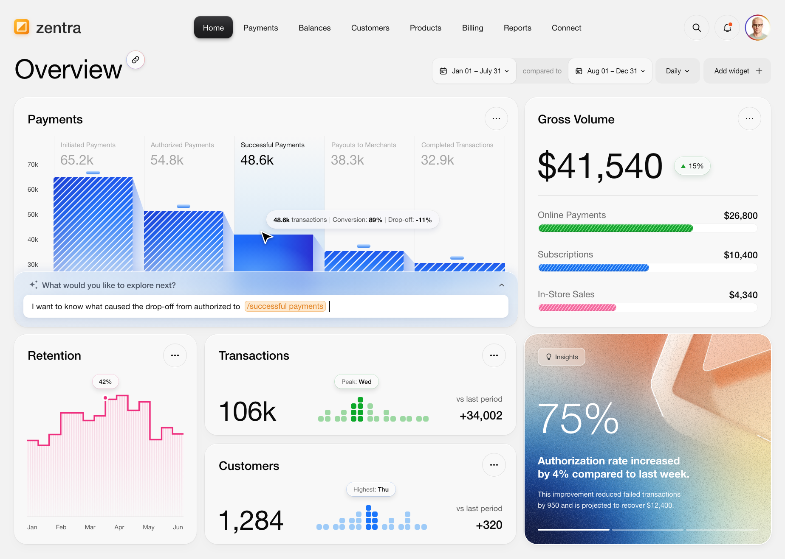

# Parlor

An interactive financial overview and payment analytics dashboard interface.



## Features

- **Executive Financial Metrics**: High-level financial KPIs, conversion funnels, and revenue metrics.
- **Payment Funnel Analytics**: Visual drop-off and conversion rates across payment stages.
- **Interactive Exploration**: Intuitive prompt and query interface for deep-diving into transaction data.
- **Modern Responsive Design**: Clean typography, pixel-crafted vectors, and custom styling.

## Getting Started

Simply open `index.html` in any modern web browser or serve with a local static server:

```bash
# Python
python3 -m http.server 8000

# or npx serve
npx serve .
```
